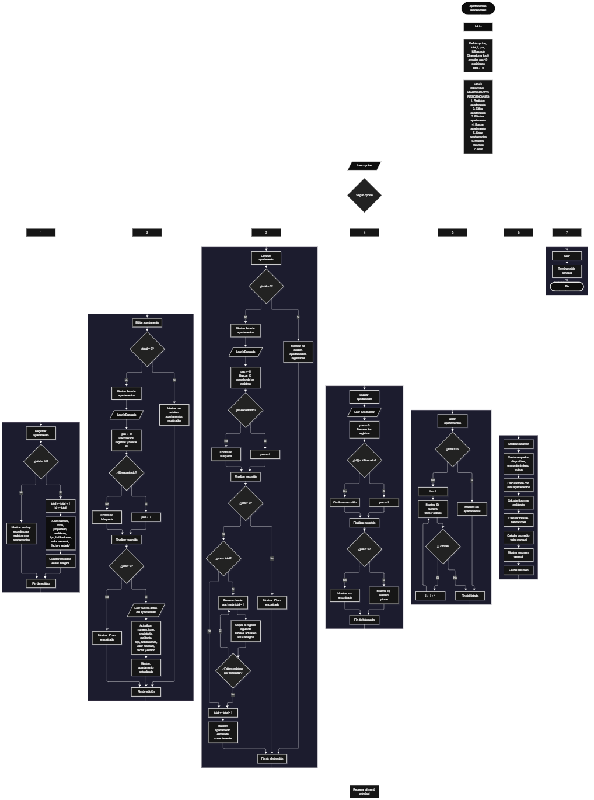

Este proyecto, llamado <b>apartamentos residenciales</b>, fue desarrollado en <b>java</b> como un ejercicio práctico para fortalecer la lógica de programación mediante la creación de un sistema de gestión de apartamentos desde la consola. El programa cuenta con un menú principal de siete opciones que permite <b>registrar, editar, eliminar, buscar, listar y analizar información de los apartamentos registrados</b>. Cada apartamento almacena datos como el número de apartamento, torre, propietario, residente, tipo de apartamento, cantidad de habitaciones, valor mensual, fecha de registro y estado actual, utilizando arreglos con una capacidad máxima de <b>10 apartamentos durante la ejecución</b>. Durante su desarrollo se aplicaron conceptos fundamentales de programación, como variables, arreglos, estructuras condicionales, ciclos repetitivos y estructuras de selección, además de procesos para buscar, modificar, eliminar y organizar registros. El programa también incorpora estadísticas relacionadas con los apartamentos registrados, permitiendo obtener información general de la colección almacenada. Este proyecto permite poner en práctica los conocimientos adquiridos en Java y sirve como base para desarrollar sistemas de gestión más avanzados utilizando otros lenguajes y tecnologías.

<h2 align="center">⚙️ Funcionamiento del menú principal</h2>

### ➕ Registrar apartamento

La opción <b>1) registrar apartamento</b> permite almacenar un nuevo apartamento residencial dentro del sistema. Antes de realizar el registro, el sistema comprueba que la cantidad de apartamentos almacenados sea menor a <b>10</b>, utilizando la condición <b>total &lt; numerosApartamentos.length</b>. Si existe espacio disponible, la variable <b>total</b> aumenta en uno y el programa genera automáticamente un identificador para el nuevo registro. Posteriormente solicita el <b>número del apartamento, torre, propietario, residente, tipo de apartamento, cantidad de habitaciones, valor mensual, fecha de registro y estado</b>. Los datos se almacenan en la posición correspondiente de sus respectivos arreglos. Finalmente, muestra el mensaje <b>"Apartamento registrado correctamente."</b>. Si el sistema alcanza su capacidad máxima, presenta el mensaje <b>"No hay espacio para registrar mas apartamentos."</b>, impidiendo registrar un nuevo apartamento.

### ✏️ Editar apartamento

La opción <b>2) editar apartamento</b> permite modificar la información de un apartamento registrado. Primero, el programa comprueba si existen apartamentos almacenados mediante la variable <b>total</b>. Si no hay registros, muestra el mensaje <b>"No existen apartamentos registrados."</b>. En caso contrario, presenta una lista con el identificador, número, torre, propietario, residente, tipo de apartamento, habitaciones, valor mensual, fecha y estado de cada apartamento. Después, solicita el identificador del apartamento que se desea editar y comprueba que esté dentro del rango permitido mediante la condición <b>idEditar &gt;= 1 y idEditar &lt;= total</b>. Si la selección es válida, solicita nuevamente toda la información del apartamento y actualiza directamente los valores de los arreglos correspondientes. Finalmente, presenta el mensaje <b>"Apartamento actualizado correctamente."</b>. Si el identificador seleccionado no corresponde a un apartamento registrado, informa que el apartamento seleccionado no existe.

### 🗑️ Eliminar apartamento

La opción <b>5) eliminar apartamento</b> permite eliminar un apartamento registrado mediante su identificador dentro de la lista. Antes de comenzar, el programa comprueba que existan apartamentos almacenados. Si la colección está vacía, muestra el mensaje <b>"No existen apartamentos registrados."</b>. Si hay registros disponibles, presenta una lista con la información de cada apartamento. Después, solicita el identificador del apartamento que se desea eliminar y verifica que la selección esté dentro del rango válido. Si el apartamento existe, comienza el proceso de eliminación. Para mantener los registros organizados, utiliza un ciclo <b>for</b> controlado por la variable <b>i</b>, que desplaza una posición hacia atrás los datos de los apartamentos posteriores en los arreglos <b>numerosApartamentos, torres, propietarios, residentes, tipos, habitaciones, valoresMensuales, fechasRegistro y estados</b>. Posteriormente, disminuye la variable <b>total</b> en uno y muestra el mensaje <b>"Apartamento eliminado correctamente."</b>. Si el identificador seleccionado no corresponde a un apartamento registrado, informa que el apartamento seleccionado no existe.

### 🔎 Buscar apartamento

La opción <b>4) buscar apartamento</b> permite localizar un apartamento mediante su identificador. Primero, el programa comprueba si existen apartamentos registrados. Si la colección está vacía, muestra el mensaje <b>"No existen apartamentos registrados."</b>. En caso contrario, solicita el identificador del apartamento que se desea buscar. A continuación, verifica que el valor introducido se encuentre dentro del rango válido mediante la condición <b>idBusqueda &gt;= 1 y idBusqueda &lt;= total</b>. Cuando encuentra una coincidencia, muestra el número del apartamento, torre, propietario, residente, tipo, habitaciones, valor mensual, fecha de registro y estado correspondiente al registro consultado. Si el identificador introducido no corresponde a ningún apartamento registrado, presenta el mensaje <b>"ID no encontrada."</b>.

### 📋 Listar apartamentos

La opción <b>3) listar apartamentos</b> permite visualizar todos los apartamentos registrados actualmente en el sistema. Antes de mostrar la información, el programa comprueba si la variable <b>total</b> es igual a cero. Si no existen registros, presenta el mensaje <b>"No existen apartamentos registrados."</b>. Si hay apartamentos disponibles, utiliza un ciclo <b>for</b> para recorrer los arreglos desde la primera posición hasta el número total de apartamentos registrados. Durante el recorrido, muestra el identificador, número de apartamento, torre, propietario, residente, tipo de apartamento, número de habitaciones, valor mensual, fecha de registro y estado de cada apartamento almacenado. Esta función facilita consultar los registros existentes sin necesidad de buscar cada apartamento individualmente.

### 📄 Mostrar resumen

La opción <b>6) mostrar resumen</b> permite consultar información estadística relacionada con los apartamentos registrados. Primero, el programa comprueba si existen apartamentos almacenados. Si la colección está vacía, muestra el mensaje <b>"No existen apartamentos registrados."</b>. En caso contrario, calcula la cantidad de apartamentos ocupados, disponibles, en mantenimiento y pertenecientes a otros estados. También determina la torre con mayor cantidad de apartamentos registrados, el tipo de apartamento más frecuente, el total de habitaciones registradas y el promedio del valor mensual de los apartamentos almacenados. Finalmente, presenta toda esta información en forma de resumen general.

### 🚪 Salir del menú principal

La opción <b>7) salir</b> está destinada a finalizar la ejecución del programa y muestra el mensaje <b>"Gracias por utilizar Apartamentos Residenciales."</b>. El menú principal se encuentra dentro de una estructura repetitiva <b>do ... while</b>, que mantiene el programa en funcionamiento mientras se realizan las operaciones disponibles. La condición final es <b>opcion != 7</b>, por lo que al seleccionar la opción 7 el programa finaliza correctamente.

<h2 align="center">🧠 Temas aplicados en el proyecto</h2>

### 📦 Variables

En este proyecto se utilizan variables para guardar la opción seleccionada en el menú, controlar la cantidad de apartamentos registrados, recorrer los arreglos, seleccionar los apartamentos que se desean editar, eliminar o consultar y almacenar los resultados estadísticos generados durante el resumen. Cada variable cumple una función específica dentro de las operaciones de gestión de apartamentos.

🔢 **Opcion:** Almacena la opción seleccionada por el usuario en el menú principal.

📊 **Total:** Almacena la cantidad actual de apartamentos registrados.

🔄 **I:** Funciona como contador en los ciclos <b>for</b> y permite seleccionar la posición de un apartamento.

🆔 **IdEditar:** Almacena el identificador del apartamento que se desea modificar.

🔎 **IdBusqueda:** Almacena el identificador utilizado para realizar una búsqueda.

🗑️ **IdEliminar:** Almacena el identificador del apartamento que se desea eliminar.

📈 **PromedioValor:** Almacena el promedio calculado de los valores mensuales registrados.

### 🗃️ Arreglos

En este proyecto se utilizan nueve arreglos relacionados con los datos de cada apartamento. Cada arreglo tiene una capacidad de <b>10 posiciones</b> y utiliza el mismo índice para representar la información correspondiente a una misma unidad residencial. Por ejemplo, los datos de un apartamento almacenado en una posición determinada se encuentran distribuidos entre todos los arreglos definidos.

🏠 **NumerosApartamentos[10]:** Almacena los números de los apartamentos registrados.

🏢 **Torres[10]:** Almacena la torre a la que pertenece cada apartamento.

👤 **Propietarios[10]:** Almacena los propietarios registrados.

👥 **Residentes[10]:** Almacena los residentes de cada apartamento.

📋 **Tipos[10]:** Almacena los tipos de apartamento.

🛏️ **Habitaciones[10]:** Almacena la cantidad de habitaciones.

💰 **ValoresMensuales[10]:** Almacena el valor mensual asociado al apartamento.

📆 **FechasRegistro[10]:** Almacena las fechas de registro.

📌 **Estados[10]:** Almacena el estado actual de cada apartamento.

### 🔀 Estructuras condicionales

En este proyecto se utilizan las estructuras <b>if</b> y <b>else</b> para comprobar si el sistema dispone de espacio antes de registrar un apartamento, verificar si existen registros antes de realizar determinadas operaciones, validar el identificador seleccionado para editar, eliminar o consultar un apartamento y clasificar los estados utilizados durante el resumen estadístico. Estas condiciones permiten que el programa responda de manera diferente según el estado del sistema y el resultado de cada operación.

### 🔄 Estructuras repetitivas

En este proyecto se utilizan los ciclos <b>for</b> y <b>do ... while</b>. Los ciclos <b>for</b> permiten recorrer los arreglos para mostrar los apartamentos, realizar búsquedas, generar estadísticas y acceder a los registros seleccionados. Durante la eliminación, también se utilizan para desplazar los datos de los apartamentos posteriores una posición hacia atrás. Por otro lado, el ciclo <b>do ... while</b> mantiene activo el menú principal para que el usuario pueda ejecutar diferentes operaciones antes de salir del programa.

### 🎯 Estructura según

El programa evalúa el valor almacenado en la variable <b>opcion</b> y ejecuta el bloque de instrucciones correspondiente. Cada caso representa una operación específica del sistema: <b>registrar, editar, eliminar, buscar, listar, mostrar resumen o salir</b>. También se utiliza el bloque <b>default</b> para mostrar el mensaje <b>"Opcion no valida."</b> cuando el valor introducido no coincide con ninguna de las opciones definidas.

### 🔢 Dimensionamiento de arreglos

El programa utiliza arreglos con una capacidad de <b>10 posiciones</b> para almacenar la información relacionada con los apartamentos registrados. La cantidad de posiciones ocupadas se controla mediante la variable <b>total</b>, por lo que las operaciones recorren únicamente los registros comprendidos entre la primera posición y el total actual de apartamentos.

### 🔄 Reorganización de registros

Cuando se selecciona un apartamento para eliminarlo, el programa utiliza un ciclo <b>for</b> que comienza en la posición seleccionada y llega hasta <b>total - 1</b>. En cada repetición, los datos de la posición siguiente se copian sobre la posición actual en los arreglos <b>numerosApartamentos, torres, propietarios, residentes, tipos, habitaciones, valoresMensuales, fechasRegistro y estados</b>. Después, la variable <b>total</b> disminuye en uno. De esta manera, los apartamentos posteriores ocupan las posiciones disponibles sin dejar espacios vacíos entre los registros activos.

<h2 align="center">¿Cómo se implementaron las operaciones crud en el proyecto?</h2>

Las operaciones <b>crud</b> se implementaron mediante las opciones del menú principal, permitiendo administrar los apartamentos registrados. La operación <b>crear</b> corresponde a <b>registrar apartamento</b>, donde se introducen los datos de una nueva unidad residencial; <b>leer</b> se realiza mediante las opciones <b>buscar apartamento, listar apartamentos y mostrar resumen</b>; <b>actualizar</b> corresponde a <b>editar apartamento</b>, donde se modifican los datos de una unidad residencial registrada; y <b>eliminar</b> se realiza mediante la opción <b>eliminar apartamento</b>. Estas operaciones utilizan variables, arreglos, condicionales y ciclos para gestionar la información almacenada temporalmente durante la ejecución del programa.

<h2 align="center">Diagrama de flujo del proyecto</h2>

<h2 align="center">🛡️ Validaciones del programa</h2>

### 📭 No existen apartamentos registrados

Esta validación se utiliza en las opciones de <b>editar, eliminar, buscar, listar y mostrar resumen</b>. El programa comprueba si la variable <b>total</b> es igual a <b>0</b> y, si no existen apartamentos registrados, muestra el mensaje <b>"No existen apartamentos registrados."</b>. Esta comprobación evita continuar con las operaciones que necesitan información almacenada cuando el sistema está vacío.

### ⚠️ Capacidad máxima alcanzada

Esta validación se utiliza durante el registro de nuevos apartamentos para controlar la capacidad máxima de los arreglos. El programa comprueba si <b>total &lt; numerosApartamentos.length</b> antes de permitir agregar un nuevo registro. Si existe espacio disponible, aumenta el contador y solicita los datos del apartamento. En caso contrario, muestra el mensaje <b>"No hay espacio para registrar mas apartamentos."</b>, impidiendo registrar más apartamentos mientras se mantenga la capacidad máxima.

### ❌ Apartamento no encontrado

Esta validación se utiliza durante las operaciones de búsqueda, edición y eliminación. Antes de realizar estas operaciones, el programa verifica que el identificador introducido sea mayor o igual a <b>1</b> y menor o igual al valor de <b>total</b>. Si la selección se encuentra fuera de ese rango, muestra el mensaje <b>"ID no encontrada."</b>.

### 🔢 Selección de apartamentos

El programa utiliza identificadores para seleccionar los apartamentos que se desean editar, eliminar o consultar. Antes de realizar estas operaciones, comprueba que el identificador introducido corresponda a un apartamento existente dentro del sistema. Esta validación evita acceder a posiciones que no contienen información válida.

### ⚠️ Opción inválida

La estructura <b>switch</b> incluye el bloque <b>default</b>, que muestra el mensaje <b>"Opcion no valida."</b> cuando el usuario introduce un número que no corresponde a ninguna de las opciones definidas en el menú.

<h2 align="center">🎯 Objetivo del proyecto</h2>

El objetivo principal de este proyecto es fortalecer la <b>lógica de programación</b> mediante el desarrollo de un sistema de gestión de apartamentos residenciales en <b>java</b>. A través de su construcción se busca aplicar los conocimientos adquiridos sobre variables, arreglos, estructuras condicionales, ciclos repetitivos y estructuras de selección, integrándolos para resolver un problema de manera organizada. Además, el proyecto permite comprender cómo registrar, consultar, modificar, eliminar y analizar información en una aplicación de consola, estableciendo una base para desarrollar sistemas de gestión más completos con otros lenguajes y tecnologías.

